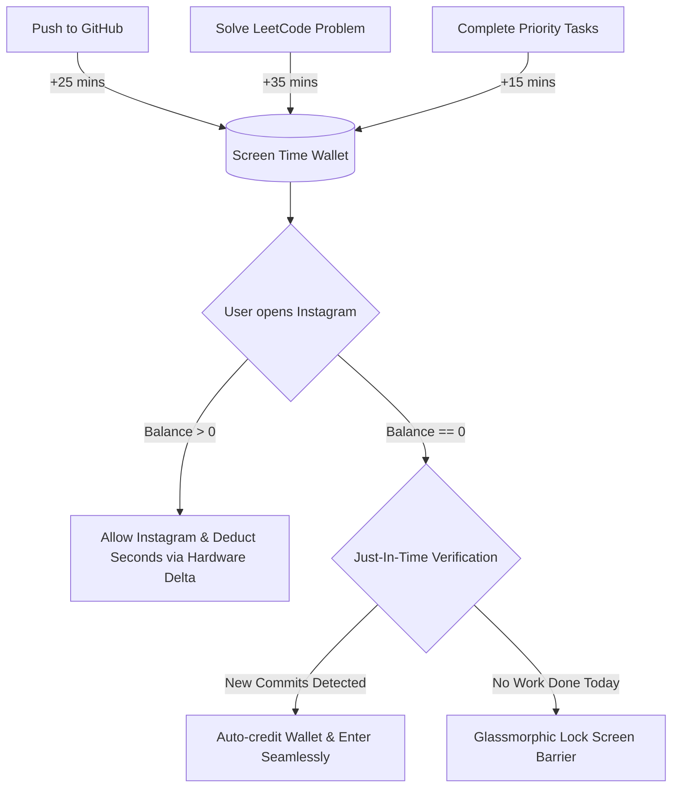

# ProofOfWork

**Earn your dopamine. Lock distractions behind verified code.**

A native, ultra-battery-efficient Android productivity app that blocks social media (Instagram, YouTube, etc.) until you earn screen time by **pushing code to GitHub**, **solving LeetCode problems**, and completing **custom daily tasks**.

[](https://developer.android.com)
[](https://kotlinlang.org)
[](https://developer.android.com/jetpack/compose)
[](#-zero-battery-architecture)
[](LICENSE)

---

## 💡 The Philosophy: "The Screen Time Economy"

Traditional website and app blockers fail because they rely on blunt schedules or willpower that you eventually bypass. 

**ProofOfWork** treats screen time like an economy with a **zero baseline balance**:
* Every morning, your Instagram allowance is locked at **0 minutes**.
* You **mint** screen time minutes directly into your local wallet by providing verifiable proofs of work.
* Open Instagram with zero balance? A glassmorphic lock screen covers it until you ship code.



---

## ✨ Features

### 1. 🔍 Automated Proof-of-Work Verification
* **GitHub Calendar Scanner (`GitHubService.kt`):**
  * Direct HTTP inspection of the official GitHub contribution graph.
  * Captures public commits, private repo commits, pull requests, and branch merges.
  * Real-time pushed repository and commit message detection.
  * True streak calculator (`🔥 XD STREAK`).
* **LeetCode GraphQL Integration (`LeetCodeService.kt`):**
  * Queries `recentAcSubmissionList` and `userCalendar` via raw `HttpURLConnection`.
  * Verifies accepted solutions for today.
* **Daily Priority Tasks:**
  * Offline SQLite/Room checklist for offline duties (studying, reading, assignments).
  * Earn custom minutes per task completed.

### 2. ⚡ Just-In-Time Auto-Verification
* You **never have to open ProofOfWork to press "Verify"**:
  * Pushed code during the day and opened Instagram at 8:00 PM?
  * At the microsecond of launch, the Accessibility Service executes a **0.3s background check** against GitHub.
  * If work was done today, it credits your account on the spot and **never shows the lock screen**!
* **Smart Throttling:** Throttles re-checks to 3 minutes if no commits were found to prevent battery drain from repeated app tapping.

### 3. 🔋 Zero-Battery Architecture
* **Timestamp Delta (`SystemClock.elapsedRealtime()`):**
  * **Zero Polling Loops:** No `while(true)` loops running in the background.
  * When you open Instagram: records `startTime`.
  * When you exit Instagram or switch apps: calculates `elapsed = endTime - startTime`.
  * **Result:** While you scroll, ProofOfWork executes **zero lines of code** (0% CPU).
* **True to the Second:** Opening Instagram for 20 seconds saves 20 seconds. Later opening for 40 seconds completes the 1-minute deduction.
* **No Background Lockouts:** Switching to WhatsApp or Home Screen pauses the timer immediately; background apps in your recent apps tray never drain your balance.

### 4. 🎨 Modern 2026 OLED Bento UI
* **Obsidian OLED Palette:** Deep black (`#08090B`) saving maximum battery on AMOLED displays.
* **Dual Radial Arc Gauge:**
  * 🟢 **Neon Emerald Arc:** GitHub Push progress.
  * 🟡 **Electric Amber Arc:** LeetCode Solve progress.
  * Center displays available screen time.
* **Contribution Heatmap Matrix:**
  * 10-week calendar grid (Mon–Sun) with weekday labels (`M`, `W`, `F`, `S`) and dynamic luminance scaling.
* **Full Customization:**
  * Slider to customize reward minutes per GitHub push (5m to 120m).
  * Slider to customize reward minutes per LeetCode solve (5m to 120m).
  * Daily free allowance grace period slider (0m to 60m).

### 5. 🛡️ OS & Privacy Respecting
* **NO Anti-Bypass Traps:** Does NOT intercept system settings or package managers. You can access phone settings or uninstall the app anytime without lockout.
* **Zero Authentication Required:** Operates strictly on public profile APIs. No personal access tokens or passwords needed.

---

## 🛠️ Tech Stack

| Layer | Technology |
| :--- | :--- |
| **Language** | Kotlin 2.0.21 |
| **UI Framework** | Jetpack Compose (BOM 2024.09.03) + Material Design 3 |
| **Architecture** | MVVM + Unidirectional Data Flow (StateFlow / Coroutines) |
| **Local Storage** | Jetpack DataStore (Preferences) + Room Database 2.6.1 |
| **Networking** | Pure `java.net.HttpURLConnection` (Zero third-party SDK bloat) |
| **App Interception** | Android `AccessibilityService` (`TYPE_WINDOW_STATE_CHANGED`) |
| **Min / Target SDK** | Min SDK 26 (Android 8.0) • Target SDK 35 (Android 15) |

---

## 🚀 Getting Started

### Prerequisites
* Android device (Android 8.0+)
* Android SDK 35 / Java 17+ or 22

### Fast Build & Deploy
Clone the repository and run the fast deployment script:
```powershell
git clone https://github.com/napraveen/ProofOfWork.git
cd ProofOfWork
.\run.ps1
```

### Manual Build
```bash
./gradlew assembleDebug
adb install -r app/build/outputs/apk/debug/app-debug.apk
```

### Setup on Phone
1. Open **ProofOfWork**.
2. Tap the **Settings (⚙️)** icon:
   * Enter your **GitHub** and **LeetCode** handles.
   * Adjust your reward sliders and daily free allowance.
   * Tap **Open Accessibility Settings** and toggle on **ProofOfWork Focus Blocker**.
3. You're all set! Ship code to unlock your scroll time.

---

## 📄 License
This project is open-source and licensed under the [MIT License](LICENSE).
